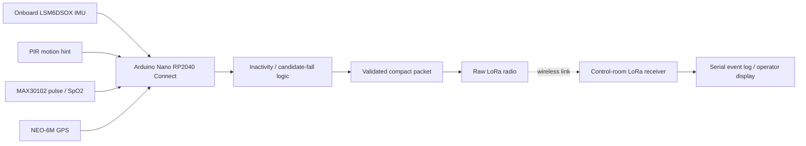
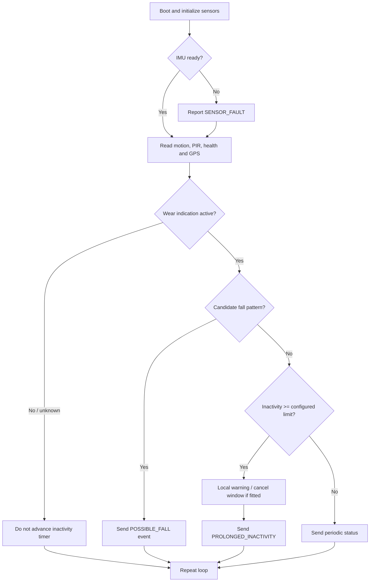

# Smart Safety Helmet for Industrial and Construction Workers


An educational embedded-systems prototype intended to monitor helmet movement, prolonged inactivity, pulse/SpO₂ readings when valid, and GPS location, then send status and emergency packets to a control-room receiver over raw LoRa.

> **Safety notice:** This is a student prototype, not a certified PPE device or medical device. Inactivity is not proof of a fall or medical emergency. Do not rely on this project as the sole safety system in a workplace. Validate hardware, firmware, radio compliance, sensor performance, and alert-handling independently before any field use.

## Project overview

### Problem statement
Industrial and construction workers may need rapid assistance after a fall, prolonged inactivity, or a reported health warning. A wearable prototype can provide a local indication and send a structured event to a receiver.

### Objectives
- Monitor motion with the Nano RP2040 Connect's onboard LSM6DSOX IMU.
- Use a PIR sensor only as an infrared-motion hint; it **cannot reliably confirm that a helmet is being worn**.
- Read MAX30102 pulse and SpO₂ estimates only when the sensor reports usable data.
- Track NEO-6M GPS fix validity and fix age.
- Send status and event packets using a selected raw-LoRa SX127x-style radio.
- Keep unverified wiring and thresholds configurable and clearly documented.

## Current implementation status

| Area | Status |
|---|---|
| Helmet-side firmware structure | Provisional implementation included |
| Onboard IMU interface | Uses `Arduino_LSM6DSOX`; verify installed library and board package |
| MAX30102 | Uses SparkFun MAX3010x library; pulse/SpO₂ algorithm is a demo estimate and needs validation |
| GPS | Uses TinyGPSPlus over `Serial1`; confirm pins and UART availability |
| LoRa | Assumes a raw SX1278/SX1276-compatible module using the Sandeep Mistry `LoRa` library; **not LoRaWAN** |
| Control-room receiver | Provisional Arduino receiver included |
| Computer dashboard | Not implemented; future enhancement |
| Certified fall/medical detection | Not implemented and not claimed |

## System architecture



## Working principle



## Hardware components

| Component | Purpose | Important note |
|---|---|---|
| Arduino Nano RP2040 Connect | Main controller and onboard IMU | Do not confuse with Nano ESP32 or Raspberry Pi Pico |
| PIR module | Detects infrared motion nearby | Not a reliable helmet-wear detector |
| MAX30102 | Optical pulse and SpO₂ estimates | Needs stable skin contact and validated algorithm |
| NEO-6M | Outdoor GNSS coordinates | May not obtain a fix indoors |
| SX1278 / compatible raw LoRa module | Radio link | Exact module, frequency, antenna, and legal settings must be confirmed |
| Battery + regulator | Portable power | Choose after measuring current and confirming module voltage requirements |
| Optional buzzer, cancel button | Local warning and false-alarm cancellation | Not included in the default pin map unless wired |

## Hardware compatibility checklist — complete before powering

- [ ] Confirm the board says **Arduino Nano RP2040 Connect**.
- [ ] Confirm the radio module exact model and whether it is raw LoRa or LoRaWAN.
- [ ] Confirm the radio's supported frequency band and local legal operating parameters. The default frequency in `config.h` is a placeholder and must be verified before transmission.
- [ ] Confirm all sensor and radio logic levels. Nano RP2040 Connect GPIO is 3.3 V; never feed a 5 V signal into a 3.3 V-only input.
- [ ] Confirm the actual SPI, I²C, UART, and GPIO pins from the board pinout and your wiring.
- [ ] Confirm whether `Serial1` maps to the pins selected for GPS in your board package.
- [ ] Confirm the MAX30102 breakout's regulator/level shifting and sensor library compatibility.
- [ ] Select a genuine wear-detection sensor (contact, pressure, or proximity) if helmet-wear detection is required.
- [ ] Use a second compatible LoRa node for the receiver and match radio settings exactly.

## Provisional pin map

This is a **starting hypothesis**, not a verified wiring guarantee. Check the exact board pinout and installed core before wiring.

| Signal | Proposed connection | Notes |
|---|---|---|
| MAX30102 SDA/SCL | I²C SDA/SCL pins | Share I²C bus with onboard IMU if supported |
| GPS TX → controller RX | `Serial1` RX pin (often D0 on Nano-style pinout) | Confirm mapping in board package |
| GPS RX ← controller TX | `Serial1` TX pin (often D1) | Optional; GPS configuration may not require it |
| SX127x NSS/CS | D10 | Verify SPI mapping and module wiring |
| SX127x RESET | D9 | Verify module pinout |
| SX127x DIO0 | D2 | Verify library and module |
| SX127x MOSI/MISO/SCK | Board SPI pins | Do not assume generic Nano pin labels without checking |
| PIR OUT | D3 | Ensure output voltage is safe for 3.3 V GPIO |
| Optional buzzer | D4 via suitable driver if needed | Do not exceed GPIO current limits |
| Optional cancel button | D5 to GND with `INPUT_PULLUP` | Button wiring and firmware option must agree |

**Important:** If your existing wiring uses different pins, change `config.h` and the corresponding hardware connections together. Do not connect a 5 V PIR output directly unless the output is known to be 3.3 V-safe.

## Software requirements

- Arduino IDE 2.x
- Board package for **Arduino Nano RP2040 Connect**
- Libraries:
  - `Arduino_LSM6DSOX`
  - `SparkFun MAX3010x Pulse and Proximity Sensor Library`
  - `TinyGPSPlus`
  - `LoRa` by Sandeep Mistry (for compatible raw SX127x modules)

Install libraries from **Tools → Manage Libraries**. Library names and board support can change; compile a minimal sensor example before integrating the full firmware.

## Firmware setup

1. Open `firmware/helmet_transmitter/helmet_transmitter.ino` in Arduino IDE.
2. Keep the related `.h` and `.cpp` files in the same sketch folder.
3. Select **Arduino Nano RP2040 Connect** and the correct port.
4. Review `config.h`; set radio frequency only after verifying the module and local regulations.
5. Confirm the GPS `Serial1` pin mapping, IMU initialization, and LoRa SPI pins.
6. Upload with radio transmission disabled or the antenna safely connected as required by the module manufacturer.
7. Open Serial Monitor at **115200 baud**.
8. Test each sensor separately before enabling emergency transmission.

## Control-room receiver setup

1. Use a second compatible controller and raw-LoRa radio.
2. Open `firmware/control_room_receiver/control_room_receiver.ino`.
3. Set its radio CS, RESET, DIO0, and frequency to match the transmitter.
4. Verify that the radio is the same family and settings are legal in your region.
5. Upload and open Serial Monitor at 115200 baud.
6. The receiver validates the packet format and logs the event. This is a serial receiver, not a staffed monitoring service or dashboard.

## Example packet

The firmware uses a compact comma-separated text packet to reduce payload size. Fields are:

`SH1,seq,worker,event,worn,hr,spo2,lat,lon,gps_valid,inactivity_s`

Example only:

```text
SH1,17,WORKER_001,PROLONGED_INACTIVITY,1,92,97,16.506200,80.648000,1,60
```

Invalid readings use `-1`; unavailable GPS uses `0,0,0` with `gps_valid=0`. Coordinates are not to be interpreted unless `gps_valid=1`. This is an example, not a real worker record.

## Example serial output

Exact output depends on library versions and hardware. Illustrative only:

```text
[BOOT] Smart Safety Helmet prototype
[IMU] initialized
[MAX30102] initialized; waiting for stable contact
[GPS] waiting for valid fix
[LoRa] initialized (verify regional frequency before use)
[STATUS] worn_hint=1 motion=ACTIVE hr=-1 spo2=-1 gps=GPS_UNAVAILABLE
[ALERT] PROLONGED_INACTIVITY
[TX] SH1,17,WORKER_001,PROLONGED_INACTIVITY,1,-1,-1,0.000000,0.000000,0,60
```

## Testing and calibration

Start with simulated data and bench tests. Do not stage falls or perform risky tests while wearing the prototype.

| Test | Procedure | Expected behavior |
|---|---|---|
| Normal movement | Move the powered board gently on a bench | Motion timestamp updates; inactivity timer resets |
| Helmet not worn | Set wear hint inactive / PIR quiet | Inactivity alert should not be treated as confirmed |
| Inactivity timeout | Use a shortened test timeout, then restore configured value | Prolonged-inactivity event after timer expires |
| Candidate fall | Inject simulated IMU samples first | Candidate event only; do not claim validated fall detection |
| Invalid MAX30102 | Disconnect sensor or block optical contact | Readings marked invalid, not fabricated |
| GPS unavailable | Test indoors or disconnect GPS safely | `gps_valid=0` |
| LoRa packet loss | Power down receiver during a bench test | Sender/receiver status indicates missing communication only if implemented/observed |
| Duplicate packet | Replay the same sequence number | Receiver ignores duplicate sequence for the same worker |
| Sensor init failure | Boot with one sensor disconnected | Fault logged; remaining loop continues where possible |
| False-alarm cancellation | Fit and test optional cancel button | Confirm button behavior before relying on it |
| Communication recovery | Restore receiver after interruption | New valid packets are accepted |

## Limitations and safety

- PIR detects motion in its field of view; it does not prove that a helmet is worn.
- Inactivity does not prove a fall. The fall logic is a heuristic and must be validated using a safe, labeled dataset and controlled testing.
- MAX30102 readings can be unreliable due to motion, fit, ambient light, perfusion, and hardware quality. This is not a medical diagnostic device.
- GPS may be unavailable indoors and may have stale fixes.
- Raw LoRa does not automatically provide delivery guarantees, encryption, or addressing. This prototype's packet format is not secure against spoofing.
- The sample receiver is not a guarantee that an operator sees or responds to an alert.
- Radio range, battery life, sensor accuracy, and certification are not claimed.
- Follow local radio regulations and module antenna/power requirements.

## Future enhancements

- Replace PIR-only wear hint with a contact, pressure, or proximity sensor.
- Add authenticated message integrity and a documented acknowledgment/retry protocol.
- Add a battery monitor and low-battery event.
- Add persistent event storage and a dashboard with access control.
- Validate motion detection using safe test fixtures and measured data.
- Conduct independent electrical, RF, usability, and safety review.

## Repository structure

```text
smart-safety-helmet/
├── README.md
├── LICENSE
├── .gitignore
├── CONTRIBUTING.md
├── CODE_OF_CONDUCT.md
├── SECURITY.md
├── docs/
│   ├── project-overview.md
│   ├── system-architecture.md
│   ├── working-principle.md
│   ├── circuit-connections.md
│   ├── component-list.md
│   ├── installation-guide.md
│   ├── calibration-guide.md
│   ├── testing-and-validation.md
│   ├── troubleshooting.md
│   └── limitations-and-safety.md
├── firmware/
│   ├── helmet_transmitter/
│   └── control_room_receiver/
├── examples/
│   └── sample_alert.txt
└── tests/
    └── detection_logic_test_plan.md
```

## Team and acknowledgments

- Project team: **[Add actual names and roles]**
- Institution: **[Add institution / department]**
- Faculty guide: **[Add name, if applicable]**
- Acknowledgments: **[Add only confirmed acknowledgments]**

## License

Released under the MIT License; see [`LICENSE`](LICENSE). Check your institution's requirements before publishing third-party library code or hardware design files.
