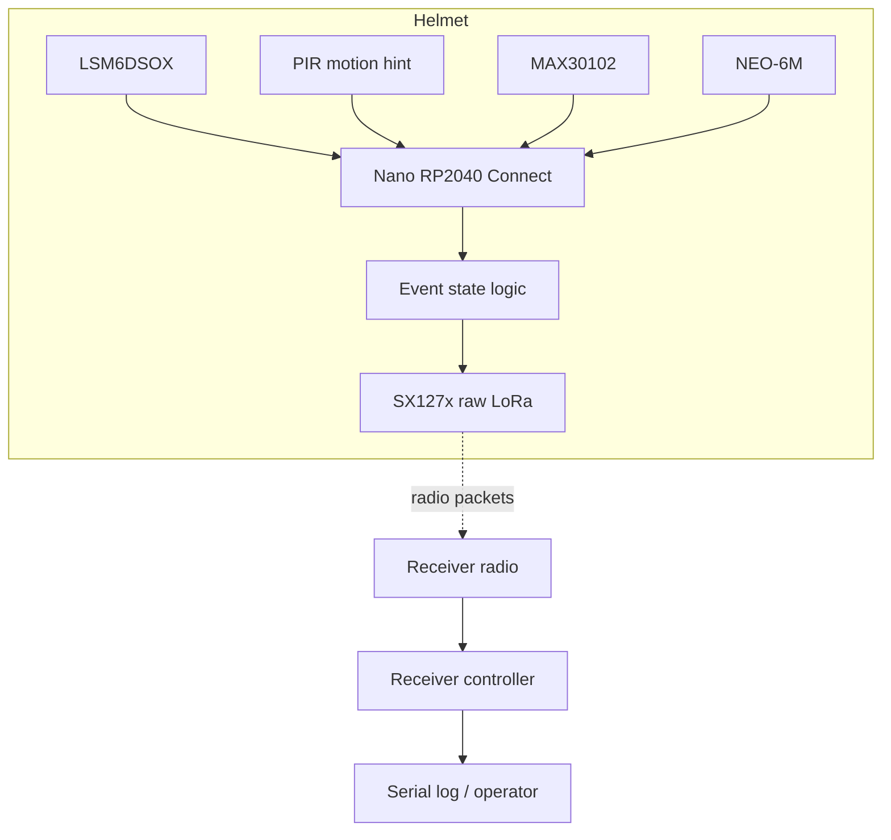

# System architecture

All pin assignments and the radio frequency are provisional until the exact modules and board pinout are verified.

# Troubleshooting

- **IMU initialization fails:** verify the exact Nano RP2040 Connect board, board package, I²C wiring if applicable, and `Arduino_LSM6DSOX` version.
- **MAX30102 unavailable:** verify I²C wiring, breakout voltage requirements, address, and library example.
- **No GPS fix:** test outdoors; confirm UART mapping and baud rate; never substitute fake coordinates.
- **LoRa init fails:** confirm exact radio family, SPI pin mapping, CS/RESET/DIO0, antenna, and library compatibility.
- **Receiver sees nothing:** match frequency and radio settings exactly, use compatible modules, and check local radio rules.
- **Compiler says `Serial1` or a pin is unsupported:** verify board selection and core pin mapping; do not assume another Nano variant has the same mapping.
- **Unreliable health values:** mark them invalid and review optical contact, movement, ambient light, and algorithm limitations.
