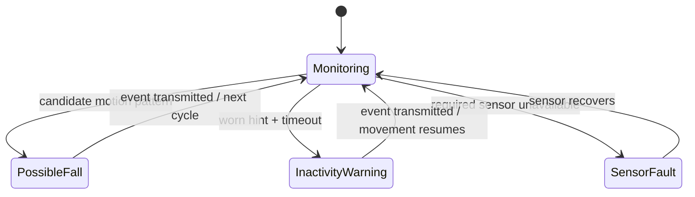

# Working principle

1. Initialize the onboard IMU, optical sensor, GNSS parser, and radio.
2. Read motion at a regular interval and update the last meaningful-motion timestamp.
3. Use the configured PIR signal as an occupancy-related hint only.
4. Read pulse/SpO₂ estimates only when valid data is available.
5. Accept GPS coordinates only when TinyGPSPlus reports a valid fix with an acceptable age.
6. Generate `POSSIBLE_FALL`, `PROLONGED_INACTIVITY`, `HEALTH_WARNING`, or `SENSOR_FAULT` as appropriate.
7. Send a compact packet; the receiver validates the packet and ignores duplicate sequence numbers.

This state diagram is explanatory; threshold tuning and real-world detection validation remain project work.
